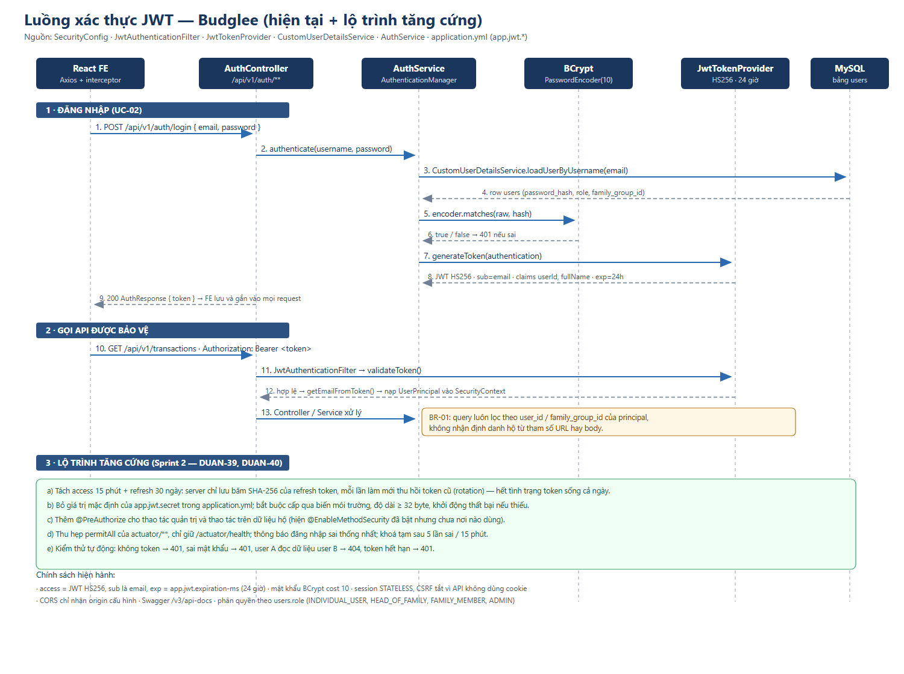

# THIẾT KẾ LUỒNG XÁC THỰC — SPRING SECURITY + JWT
**Issue:** DUAN-29 · **Sprint:** 1 · **Người thực hiện:** Nguyễn Trường An (Backend Lead)
**Tài liệu đối chiếu:** `backend/src/main/java/com/budglee/finance/config/SecurityConfig.java`, `security/JwtTokenProvider.java`, `security/JwtAuthenticationFilter.java`, `security/CustomUserDetailsService.java`, `security/UserPrincipal.java`, `service/AuthService.java`, `resources/application.yml`

---

## 1. Căn cứ kỹ thuật (phần nghiên cứu)

| Nguồn / công nghệ | Kết luận rút ra cho dự án |
|---|---|
| Spring Security 6 (mô hình `SecurityFilterChain`, không còn `WebSecurityConfigurerAdapter`) | Khai báo cấu hình bằng bean `SecurityFilterChain`, chuỗi filter tự mô tả được |
| Stateless session cho API | `SessionCreationPolicy.STATELESS` + tắt CSRF + tắt form login / http basic |
| JWT (RFC 7519), thư viện `jjwt` | Ký HS256 với khoá ≥ 256 bit; payload chỉ đặt thông tin định danh tối thiểu |
| BCrypt (`BCryptPasswordEncoder`) | Lưu mật khẩu dạng băm có salt, cost mặc định 10 |
| `@EnableMethodSecurity` | Kiểm soát quyền theo phương thức (`@PreAuthorize`) — **đã bật cấu hình nhưng chưa áp dụng**, xem mục 5 |
| OWASP API Security Top 10 | B01 Broken Access Control: mọi truy vấn phải lọc theo chủ thể đang đăng nhập, không tin định danh gửi từ client |

## 2. Thiết kế hiện tại (đúng như mã trong repo)

### 2.1 Thành phần
```
Browser (React + Axios)
   └─ Header: Authorization: Bearer <token>
        │
        ▼
JwtAuthenticationFilter  ──► JwtTokenProvider.validateToken / getEmailFromToken
        │                                    ▲
        ▼                                    │ app.jwt.secret, expiration-ms
CustomUserDetailsService ──► UserRepository (DB)
        │
        ▼
SecurityContext (UserPrincipal) ──► Controller / Service
```

| Thành phần | Trách nhiệm |
|---|---|
| `JwtTokenProvider` | Ký và xác minh token HS256; claim `sub` = email, `userId`, `fullName`; thời hạn `app.jwt.expiration-ms` |
| `JwtAuthenticationFilter` | Đọc header, xác minh token, nạp `UserDetails`, đặt `Authentication` vào `SecurityContext`; lỗi thì bỏ qua để cấu hình an ninh trả 401/403 |
| `CustomUserDetailsService` | Tra `users` theo email, trả `UserPrincipal` kèm role thành quyền `ROLE_*` |
| `AuthService` | **Mục tiêu**: đăng ký (kiểm tra email trùng, băm BCrypt, lưu user) và đăng nhập qua `AuthenticationManager`. **Trạng thái nhánh `an`: hai hàm đã cài xong — đăng ký băm BCrypt và chặn email trùng (409), đăng nhập đi qua `AuthenticationManager` rồi cấp token HS256 thật; `mock-token` đã bị xoá.**** |
| `SecurityConfig` | `permitAll` cho `/api/v1/auth/**`, swagger và actuator; còn lại yêu cầu xác thực; CORS theo danh sách origin cấu hình |

### 2.2 Trình tự đăng nhập

> Trình tự dưới đây đã chạy đúng trên nhánh `an`, kiểm chứng bằng `AuthAndTransactionFlowTest` và `StatusCodeOverRealHttpTest`; chưa hoà vào `develop`.

1. FE `POST /api/v1/auth/login` kèm email + mật khẩu.
2. `AuthService` gọi `AuthenticationManager.authenticate(...)`.
3. `DaoAuthenticationProvider` gọi `CustomUserDetailsService.loadUserByUsername(email)`.
4. So khớp mật khẩu bằng `BCryptPasswordEncoder.matches(raw, password_hash)`.
5. Thành công → `JwtTokenProvider.generateToken(authentication)` ký HS256.
6. Trả `AuthResponse { token, ... }`; FE lưu token và gắn vào mọi request qua Axios interceptor.

### 2.3 Trình tự một request có bảo vệ
1. `JwtAuthenticationFilter` tách token khỏi header.
2. `validateToken` kiểm tra chữ ký và hạn; hết hạn/sai chữ ký → không đặt `Authentication`.
3. `getEmailFromToken` → nạp user → đặt `Authentication` vào `SecurityContext`.
4. `AuthorizeHttpRequests` cho qua vì đã xác thực; controller lấy principal hiện hành để **lọc dữ liệu theo user / `family_group_id`** (BR-01).

## 3. Sơ đồ trình tự



Mã nguồn sơ đồ: [`diagrams/03-jwt-sequence.svg`](diagrams/03-jwt-sequence.svg)

## 4. Quyết định thiết kế và hệ quả

| Quyết định | Lý do | Hệ quả cần theo dõi |
|---|---|---|
| Một token duy nhất, hạn 24 giờ | Đơn giản cho MVP, đủ cho demo | Không thu hồi được trước hạn; nếu lộ token thì kẻ tấn công có 24 giờ |
| `sub` là email | Tra user trực tiếp trong filter | Đổi email sẽ làm token cũ vô hiệu — chấp nhận được |
| Vai trò đặt trong `users.role`, không có bảng trung gian hộ | Ít bảng, triển khai nhanh | Không quản lý được vai trò *trong* từng hộ khi một người tham gia nhiều hộ |
| Không lưu token ở server | Stateless, dễ scale | Muốn đăng xuất thật sự phải có blacklist Redis hoặc lưu session |

## 5. Lộ trình tăng cứng (An đề xuất cho Sprint 2 — DUAN-39, DUAN-40)

| # | Việc | Vì sao phải làm |
|---|---|---|
| 1 | **Bỏ secret mặc định** trong `application.yml`, bắt buộc cấp qua `JWT_SECRET` và fail-fast nếu thiếu hoặc < 32 byte | Hiện file cấu hình đang chứa một khoá cố định; ai đọc được repo là ký được token hợp lệ |
| 2 | Tách **access token 15 phút + refresh token 30 ngày**, server chỉ lưu **băm SHA-256** của refresh token, mỗi lần làm mới thu hồi token cũ | Khắc phục hệ quả mục 4, cho phép thu hồi phiên |
| 3 | Thêm **`@PreAuthorize`** cho các thao tác quản trị và thao tác trên dữ liệu hộ | `@EnableMethodSecurity` đã bật nhưng chưa có chỗ nào dùng → quyền chỉ đang "trang trí" |
| 4 | Thu hẹp `permitAll` của `actuator/**`, chỉ giữ `/actuator/health` | Hiện lộ hết endpoint quản trị |
| 5 | Trả thông báo lỗi xác thực **như nhau** cho email không tồn tại và mật khẩu sai; khoá tạm sau 5 lần sai trong 15 phút | Chống dò tài khoản và brute force |
| 6 | Thêm kiểm thử tự động: sai mật khẩu → 401, không token → 401/403, user A truy cập dữ liệu user B → 404, token hết hạn → 401 | Các quy tắc này hiện chỉ kiểm tra thủ công |
| 7 | Cấu hình Redis blacklist cho đăng xuất thật (UC-03) | Để "Đăng xuất" không chỉ là xoá token phía trình duyệt |

## 6. Ghi chú triển khai cho frontend
- Axios interceptor gắn `Authorization: Bearer` từ store; khi gặp 401 thì xoá phiên và chuyển về trang đăng nhập.
- Không đưa token vào URL, không log token.
- Không tự "ẩn nút" rồi coi là phân quyền — quyền thật do server quyết định (BR-11).

## 7. Lịch sử
| Ngày | Thay đổi |
|---|---|
| 27/10/2026 | Bản Sprint 1: tổng hợp nghiên cứu Spring Security/JWT, mô tả thiết kế hiện có, sơ đồ trình tự, lộ trình tăng cứng 7 mục |
