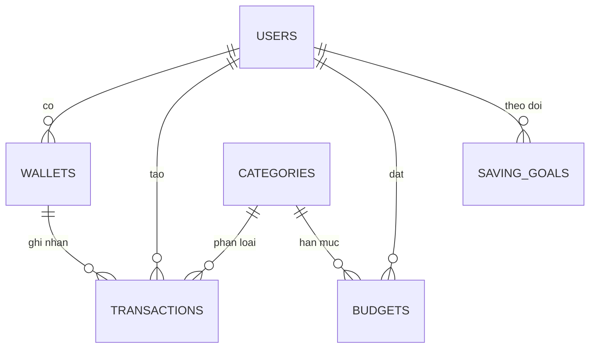

# ĐẶC TẢ YÊU CẦU PHẦN MỀM (SRS)
## Budglee Platform — Hệ thống Quản lý thu chi cá nhân và gia đình

| Hạng mục | Nội dung |
|---|---|
| Mã dự án | PRJ-FINANCE-BUDGLEE-01 |
| Học phần | Phát triển Dự án Phần mềm / Đồ án Chuyên ngành |
| Lớp học phần | HN-KS24-CNTT3 |
| Nhóm | Nhóm 03 (04 thành viên) |
| Giảng viên hướng dẫn | ThS. Hồ Xuân Hùng |
| Phiên bản | 1.0 — Sprint 1 |
| Người chịu trách nhiệm | Nguyễn Trường An (Leader / Backend Lead) |
| Issue tương ứng | DUAN-28 (đề cương + SRS), DUAN-29 (luồng xác thực) |
| Tham chiếu | [`JWT-AUTHENTICATION-DESIGN.md`](JWT-AUTHENTICATION-DESIGN.md) · [`diagrams/`](diagrams) · `README.md` · mã nguồn `backend/src/main/java/com/budglee/finance` |

> Tài liệu này **mô tả đúng hệ thống đang có trong repo**. Mọi số liệu (số bảng, tên cột, endpoint, tham số) đều đối chiếu trực tiếp với `V1__init_schema.sql`, `controller/*.java` và `application.yml`. Những gì **chưa làm** được ghi rõ ở mục 8 và 11 thay vì viết chung chung.

---

## 1. Giới thiệu

### 1.1 Mục đích
Phần mềm cho phép một cá nhân hoặc một hộ gia đình ghi nhận thu – chi, quản lý nhiều ví/danh mục, đặt hạn mức ngân sách kèm cảnh báo, theo dõi mục tiêu tiết kiệm và xem thống kê trực quan.

### 1.2 Phạm vi
- **Trong phạm vi**: ghi nhận giao dịch, ví, danh mục, ngân sách, mục tiêu tiết kiệm, dashboard thống kê, gợi ý thói quen chi tiêu dựa trên quy tắc, xác thực JWT, phân quyền vai trò, đóng gói Docker và CI/CD.
- **Ngoài phạm vi giai đoạn này**: kết nối ngân hàng thật, thanh toán, mobile app riêng, AI/ML suy luận (gợi ý hiện là quy tắc), đa ngôn ngữ, hoá đơn điện tử.

### 1.3 Định nghĩa và viết tắt
| Thuật ngữ | Nghĩa |
|---|---|
| JWT | JSON Web Token — token truy cập do server ký |
| `family_group_id` | Định danh nhóm hộ gia đình, là khoá phân vùng dữ liệu (multi-tenant) |
| ACID | Giao dịch CSDL đảm bảo Nguyên tử – Nhất quán – Độc lập – Bền vững |
| MVP | Bản tối thiểu khả dụng |

---

## 2. Tổng quan hệ thống

### 2.1 Các nhóm người dùng (actors)
| Actor | Mô tả | Quyền chính |
|---|---|---|
| **Khách** | Chưa đăng nhập | Chỉ xem trang đăng nhập / đăng ký |
| **Người dùng cá nhân** (`INDIVIDUAL_USER`) | Tự quản lý thu chi của mình | CRUD ví, danh mục riêng, giao dịch, ngân sách, mục tiêu, xem dashboard |
| **Chủ hộ gia đình** (`HEAD_OF_FAMILY`) | Tạo và quản lý nhóm chi tiêu chung | Toàn quyền với dữ liệu của `family_group_id`; thêm / gỡ thành viên |
| **Thành viên hộ** (`FAMILY_MEMBER`) | Tham gia hộ do người khác tạo | Ghi nhận giao dịch, xem ngân sách và thống kê chung |
| **Quản trị hệ thống** (`ADMIN`) | Ban vận hành | Quản lý danh mục mặc định, khoá tài khoản, xem log hệ thống |

### 2.2 Môi trường triển khai
| Lớp | Công nghệ | Ghi chú |
|---|---|---|
| Frontend | React 18 + Vite + TypeScript + Tailwind + Recharts + Zustand | `frontend/`, gọi API qua `services/api.ts` |
| Backend | Spring Boot 3.2.x, Spring Security + JWT, Spring Data JPA | `backend/`, Maven (`pom.xml`), package `com.budglee.finance` |
| CSDL | MySQL 8.0, migration Flyway | 6 bảng, xem mục 6 |
| Cache | Redis 7 | thống kê dashboard, blacklist token |
| Hạ tầng | Docker Compose, Nginx reverse proxy, GitHub Actions | `devops/`, `.github/workflows/ci.yml` |

---

## 3. Yêu cầu chức năng

Ký hiệu UC. Cột **Hiện trạng** đánh giá theo mã trong repo tại thời điểm viết SRS
(commit `23ae13a` refactor scaffold). Từ khoá:

- ✅ = chạy được thật, có logic nghiệp vụ.
- 🟡 = **khung sườn**: endpoint/class đã có nhưng phần thân là stub `TODO` do nhóm phân công lại
  (controller rỗng gọi repo, hoặc service in log `[TODO - TÊN]`). Người sở hữu stub ghi trong mã nguồn.
- ⚠️ = một phần.
- ⬜ = chưa có.

### 3.1 Xác thực và tài khoản
| UC | Tên | Actor | Hiện trạng |
|---|---|---|---|
| UC-01 | Đăng ký tài khoản | Khách | 🟡 `POST /api/v1/auth/register` — thân `AuthService.register` là stub `[TODO - AN]` |
| UC-02 | Đăng nhập, nhận JWT | Khách | 🟡 `POST /api/v1/auth/login` — thân `AuthService.login` là stub `[TODO - AN]`; hạ tầng JWT (`JwtTokenProvider`, filter) đã ✅ |
| UC-03 | Đăng xuất / huỷ phiên | User | ⚠️ FE xoá token cục bộ; **chưa có** blacklist Redis phía server |
| UC-04 | Xem và cập nhật hồ sơ | User | ⬜ Chưa có endpoint |
| UC-05 | Lấy lại mật khẩu | Khách | ⬜ Chưa có (cần SMTP) |

### 3.2 Ví và danh mục
| UC | Tên | Actor | Hiện trạng |
|---|---|---|---|
| UC-06 | Tạo ví (tiền mặt / ngân hàng / tín dụng / e-wallet) | User | ✅ `POST /api/v1/wallets` |
| UC-07 | Xem danh sách ví và số dư | User | ✅ `GET /api/v1/wallets` |
| UC-08 | Xem danh mục hệ thống + danh mục của mình | User | ✅ `GET /api/v1/categories` |
| UC-09 | Tạo danh mục tuỳ chỉnh (icon, màu) | User | ✅ `POST /api/v1/categories` |

### 3.3 Giao dịch
| UC | Tên | Actor | Hiện trạng |
|---|---|---|---|
| UC-10 | Thêm giao dịch THU / CHI | User | 🟡 `POST /api/v1/transactions` — stub `[TODO - AN]` |
| UC-11 | Danh sách hoạt động theo thời gian | User | 🟡 `GET /api/v1/transactions` (phân trang) — stub `[TODO - AN]` |
| UC-12 | Sửa / xoá mềm giao dịch | User | ⬜ Chưa có `PUT` / `DELETE` |
| UC-13 | Lọc theo tháng, danh mục, loại, từ khoá | User | ⬜ API mới nhận tham số cơ bản |
| UC-14 | Chuyển khoản giữa hai ví | User | ⬜ `TransactionType` đã có nhưng luồng cập nhật hai chiều chưa hoàn chỉnh |

### 3.4 Ngân sách và mục tiêu
| UC | Tên | Actor | Hiện trạng |
|---|---|---|---|
| UC-15 | Đặt hạn mức chi theo danh mục / kỳ | User | 🟡 `POST /api/v1/budgets` — stub `[TODO - AN]` |
| UC-16 | Xem tiến độ và cảnh báo 80% / 100% | User | 🟡 `GET /api/v1/budgets` — stub `[TODO - AN]`; cột `alert_threshold` đã có |
| UC-17 | Tạo mục tiêu tiết kiệm và theo dõi tiến độ | User | ⚠️ Bảng `saving_goals` + repository đã có, **chưa có controller** |

### 3.5 Thống kê và gợi ý
| UC | Tên | Actor | Hiện trạng |
|---|---|---|---|
| UC-18 | Dashboard: tổng thu, tổng chi, kết dư, số dư ví | User | 🟡 `GET /api/v1/dashboard/summary` — stub `[TODO - THÀNH & TÚ]` (kèm Redis cache) |
| UC-19 | Biểu đồ cơ cấu chi và xu hướng theo thời gian | User | ⚠️ `ChartSection.tsx` (Recharts) hiển thị được, nhưng dữ liệu đang lấy từ store mock, chưa gọi API |
| UC-20 | Bot gợi ý điều chỉnh thói quen chi tiêu | User | 🟡 `GET /api/v1/dashboard/recommendations` — stub `[TODO - THÀNH]` |
| UC-21 | Xuất báo cáo CSV / Excel / PDF | User | ⬜ Kế hoạch Sprint 4 (DUAN-61) |

### 3.6 Hộ gia đình và quản trị
| UC | Tên | Actor | Hiện trạng |
|---|---|---|---|
| UC-22 | Tạo nhóm hộ, mời và phân quyền thành viên | Chủ hộ | ⬜ Mới có cột `family_group_id`, chưa có API quản lý thành viên |
| UC-23 | Khoá / mở tài khoản, quản lý danh mục hệ thống | Admin | ⬜ Kế hoạch Sprint 4 |

---

## 4. Quy tắc nghiệp vụ

| Mã | Quy tắc |
|---|---|
| BR-01 | **Phân vùng dữ liệu**: mỗi truy vấn phải lọc theo `user_id` hoặc `family_group_id` của người đang đăng nhập; không nhận định danh này từ phía client. |
| BR-02 | Số tiền (`amount`) là `DECIMAL(15,2)`, luôn dương; bản chất thu hay chi do `type` quyết định, không dùng số âm. |
| BR-03 | Ghi nhận giao dịch **phải cập nhật số dư ví trong cùng một transaction** (`@Transactional`) để không lệch số dư (ACID). |
| BR-04 | Giao dịch THU chỉ dùng danh mục `type=INCOME`, giao dịch CHI chỉ dùng danh mục `type=EXPENSE`. |
| BR-05 | Danh mục có `user_id IS NULL` là danh mục hệ thống, mọi người dùng thấy nhưng không sửa được. |
| BR-06 | Ngân sách tính theo kỳ; `used / amount_limit >= 80%` → cảnh báo, `>= 100%` → vượt mức, UI đổi màu thanh tiến độ. |
| BR-07 | Không cho tồn tại hai ngân sách trùng (user, category, kỳ). |
| BR-08 | Mục tiêu tiết kiệm chuyển sang `COMPLETED` khi `current_amount >= target_amount`. |
| BR-09 | Mật khẩu lưu dạng băm **BCrypt**, không bao giờ lưu dạng rõ và không trả về trong API. |
| BR-10 | Token chỉ cấp sau khi xác mật khẩu thành công; mọi endpoint ngoài `/api/v1/auth/**` yêu cầu `Authorization: Bearer`. |
| BR-11 | Vai trò `ADMIN` / `HEAD_OF_FAMILY` mới được thao tác quản trị; các thao tác này phải chặn ở server, không chỉ ẩn nút trên UI. |
| BR-12 | Xoá dữ liệu nghiệp vụ dùng xoá mềm (cột `is_deleted`) để số liệu thống kê quá khứ không đổi. |

---

## 5. Yêu cầu phi chức năng

| Mã | Yêu cầu | Cách kiểm tra |
|---|---|---|
| NFR-01 | API phản hồi < 2 giây với dữ liệu thông thường (≤ 5.000 giao dịch) | đồng hồ + log |
| NFR-02 | Bảo mật: JWT ký HS256 với secret **cấu hình qua biến môi trường**, không hardcode; HTTPS ở môi trường thật; CORS giới hạn origin | đọc `application.yml`, `curl -I` |
| NFR-03 | Bảo mật: mật khẩu BCrypt, token hết hạn, không lộ `password_hash` trong DTO | code review + test |
| NFR-04 | Hiệu năng đọc thống kê: kết quả dashboard được cache Redis, TTL cấu hình được | tắt Redis vẫn chạy (suy giảm, không lỗi) |
| NFR-05 | Khả chuyển: toàn bộ stack chạy bằng `docker compose up` | xoá volume rồi chạy lại |
| NFR-06 | Tích tục: mỗi push đều chạy build + test + lint tự động | màu xanh của GitHub Actions |
| NFR-07 | Dữ liệu: sao lưu MySQL tự động hằng ngày, khôi phục được | chạy `devops/scripts/backup.sh` rồi restore |
| NFR-08 | Giao diện responsive tới 375px, có trạng thái rỗng và thông báo lỗi API rõ ràng | kiểm tra trên trình duyệt |
| NFR-09 | Mã nguồn có sơ đồ và tài liệu thiết kế đi kèm (SRS, ERD, luồng xác thực) | mở `docs/` |
| NFR-10 | Khả năng mở rộng: tách theo layered architecture (controller / service / repository / entity), không truy vấn thẳng từ controller | code review |

---

## 6. Mô hình dữ liệu (6 bảng — khớp `V1__init_schema.sql`)

| Bảng | Vai trò | Cột chính | Ràng buộc |
|---|---|---|---|
| `users` | tài khoản + vai trò | `id`, `full_name`, `email`, `password_hash`, `avatar_url`, `role`, `family_group_id` | `email` UNIQUE; `role` mặc định `INDIVIDUAL_USER`; chỉ mục `idx_users_email`, `idx_users_family` |
| `wallets` | ví / tài khoản / thẻ | `id`, `user_id`, `family_group_id`, `wallet_name`, `card_number_masked`, `balance`, `currency`, `type` | FK `user_id` → `users` CASCADE; `balance DECIMAL(15,2)`; `type` mặc định `CASH` |
| `categories` | danh mục thu / chi | `id`, `name`, `type`, `icon`, `color_code`, `user_id` | `user_id NULL` = danh mục hệ thống; FK CASCADE; chỉ mục `idx_categories_user_type` |
| `transactions` | giao dịch | `id`, `wallet_id`, `category_id`, `user_id`, `action_title`, `amount`, `transaction_type`, `balance_after`, `transaction_date`, `note` | `amount DECIMAL(15,2)`; FK `wallet_id` CASCADE, `category_id` SET NULL; lưu `balance_after` để truy vết số dư; chỉ mục `idx_tx_user_date` |
| `budgets` | hạn mức chi theo kỳ | `id`, `user_id`, `category_id`, `amount_limit`, `spent_amount`, `period_month`, `period_year`, `alert_threshold` | Kỳ lưu dạng `period_month` + `period_year`; `alert_threshold` mặc định `80.00`; chỉ mục `idx_budgets_period` |
| `saving_goals` | mục tiêu tiết kiệm | `id`, `user_id`, `goal_name`, `target_amount`, `current_amount`, `deadline`, `status` | `status` mặc định `IN_PROGRESS`; FK `user_id` CASCADE; chỉ mục `idx_goals_user` |

**Ghi chú thiết kế**: dùng `family_group_id` dạng chuỗi để cho phép nhiều thành viên cùng thuộc một hộ mà chưa cần bảng trung gian `family_members`. Nhược điểm (không kiểm tra được tính tồn tại của hộ, khó đổi vai trò trong hộ) được ghi là nợ kỹ thuật ở mục 11.

---

## 7. Hợp đồng API (đối chiếu `controller/`)

Base URL: `http://localhost:8080/api/v1` · Swagger: `/swagger-ui.html`

| Method | Đường dẫn | Mô tả | Quyền |
|---|---|---|---|
| POST | `/auth/register` | tạo tài khoản | public |
| POST | `/auth/login` | đăng nhập, trả JWT | public |
| GET | `/wallets` | danh sách ví + số dư | user |
| POST | `/wallets` | tạo ví | user |
| GET | `/categories` | danh mục hệ thống + riêng | user |
| POST | `/categories` | tạo danh mục tuỳ chỉnh | user |
| GET | `/transactions` | danh sách hoạt động | user |
| POST | `/transactions` | thêm giao dịch + cập nhật số dư | user |
| GET | `/budgets` | ngân sách kèm tiến độ / cảnh báo | user |
| POST | `/budgets` | đặt hạn mức | user |
| GET | `/dashboard/summary` | số liệu trang tổng quan | user |
| GET | `/dashboard/recommendations` | gợi ý thói quen chi tiêu | user |

Quy ước chung: trả `ApiResponse` (`message`, `data`); lỗi trả mã HTTP tương ứng kèm thông điệp; dữ liệu luôn bị lọc theo người dùng đang đăng nhập (BR-01).

---

## 8.traceability UC → API → bảng

| UC | API | Bảng liên quan |
|---|---|---|
| UC-01, UC-02 | `/auth/register`, `/auth/login` | `users` |
| UC-06, UC-07 | `/wallets` | `wallets` |
| UC-08, UC-09 | `/categories` | `categories` |
| UC-10, UC-11 | `/transactions` | `transactions`, `wallets` |
| UC-15, UC-16 | `/budgets` | `budgets`, `categories`, `transactions` |
| UC-18, UC-19, UC-20 | `/dashboard/*` | `transactions`, `wallets`, `budgets` |

---

## 9. Tiêu chí hoàn thành (Definition of Done)

Một chức năng được coi là xong khi: (1) có API + UI tương tác được; (2) có kiểm thử tự động hoặc bước kiểm chứng trong `scripts`; (3) tuân thủ BR-01 (lọc theo user/hộ); (4) tài liệu SRS và sơ đồ được cập nhật; (5) CI xanh.

| Mã | Tiêu chí nghiệm thu |
|---|---|
| AC-01 | Đăng ký → đăng nhập → nhận token → gọi API có token trả 200, không token trả 401/403 |
| AC-02 | Thêm giao dịch CHI làm giảm đúng số dư ví; thêm giao dịch THU làm tăng đúng số dư |
| AC-03 | Ngân sách chạm 80% hiển thị cảnh báo, chạm 100% hiển thị vượt mức trên dashboard |
| AC-04 | Dashboard khớp với tính tay trên dữ liệu mẫu (đối chiếu `GROUP BY`) |
| AC-05 | User A không đọc/sửa được dữ liệu của user B dù đoán id (trả 404, không rò thông tin) |
| AC-06 | `docker compose up` chạy được trên máy sạch, không phải sửa code |
| AC-07 | Toàn bộ pipeline CI xanh ở commit cuối sprint |
| AC-08 | Có ảnh/video minh chứng cho mỗi luồng chính |

---

## 10. Rủi ro yêu cầu

| Rủi ro | Ảnh hưởng | Xử lý |
|---|---|---|
| Chưa kiểm soát quyền theo vai trò ở tầng server | thành viên xem/sửa được dữ liệu chủ hộ | bổ sung `@PreAuthorize` + `Role` kiểm soát trong Sprint 2 (DUAN-40) |
| `family_group_id` là chuỗi tự do, không có bảng hộ | nhập sai vẫn được chấp nhận | thêm bảng `family_groups` + FK khi làm UC-22 |
| Một token 24 giờ, không thu hồi được | lộ token = mất tài khoản cả ngày | chuyển sang access 15' + refresh có rotation (xem tài liệu thiết kế xác thực) |
| Gợi ý chi tiêu chỉ theo quy tắc cứng | thiếu tin cậy | thu thập thêm dữ liệu danh mục, công thức hoá ở Sprint 4 |

---

## 11. Nợ kỹ thuật đã ghi nhận (không che)

1. `app.jwt.secret` còn giá trị mặc định hardcode trong `application.yml` → bắt buộc chuyển hết sang biến môi trường, secret ≥ 32 byte, fail-fast nếu thiếu.
2. `actuator/**` đang `permitAll` → chỉ mở `/actuator/health`, các endpoint còn lại cần quyền admin.
3. Chưa có `PUT`/`DELETE` cho giao dịch và controller cho `saving_goals`.
4. Chưa có kiểm thử tự động ngoài `BudgleeApplicationTests` (context load).
5. Chưa có rate limiting / khoá tài khoản khi nhập sai mật khẩu nhiều lần.
6. Từ commit `23ae13a`, nhóm chủ động **rút thân hàm nghiệp vụ thành stub `TODO` có ghi tên người phụ trách**
   (`AuthService`, `TransactionService`, `BudgetService` → An; `DashboardService`, `RecommendationService` → Thành & Tú)
   để 4 thành viên làm song song không đụng file nhau. Hệ quả: UC-01/02/10/11/15/16/18/20 ở cột "Hiện trạng" chỉ là 🟡 khung sườn,
   chưa chạy được đầu-cuối cho tới khi từng stub được lấp trong Sprint 2.

## 12. Câu hỏi mở cần giảng viên chốt

| Mã | Câu hỏi |
|---|---|
| Q-01 | Một người dùng có được thuộc nhiều hộ gia đình không, hay chỉ một `family_group_id`? |
| Q-02 | Thành viên thường có được sửa/xoá giao dịch do người khác trong hộ tạo không? |
| Q-03 | Bot gợi ý dừng ở quy tắc (rule-based) hay phải có mô hình học máy? |

---

## 13. Lịch sử phiên bản
| Bản | Ngày | Thay đổi |
|---|---|---|
| 1.0 | 27/10/2026 | Bản Sprint 1: 23 UC, 12 quy tắc nghiệp vụ, 10 NFR, mô hình 6 bảng, hợp đồng API đối chiếu mã nguồn, mục nợ kỹ thuật |
